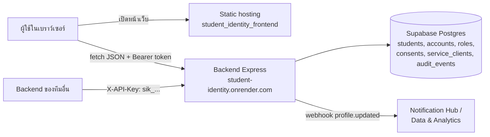
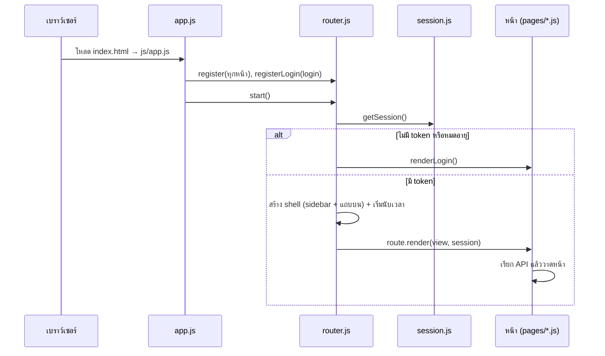
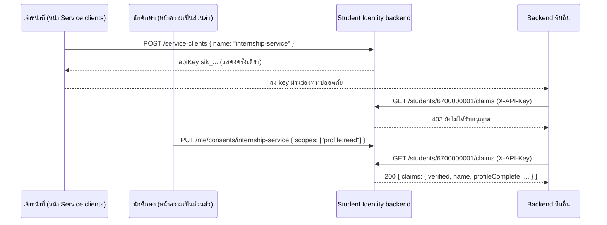

# คู่มือทีม: Student Identity Frontend (ฉบับใช้งานจริง)

เอกสารนี้อธิบายการทำงานของหน้าเว็บในโฟลเดอร์ `student_identity_frontend` สำหรับคนในทีม ทั้งการเตรียมเชื่อมต่อ, หน้าที่ของแต่ละหน้า, ข้อมูลที่ดึงมาจากไหน และการทำงานของโค้ดแต่ละไฟล์

> ฉบับทดสอบอยู่ที่ `student_identity_ui` และมีคู่มือของตัวเองแยกไว้ในโฟลเดอร์นั้น

---

## สารบัญ

1. [ภาพรวม](#1-ภาพรวม)
2. [การเตรียมเชื่อมต่อ](#2-การเตรียมเชื่อมต่อ)
3. [เปิดใช้งานและ deploy](#3-เปิดใช้งานและ-deploy)
4. [โครงสร้างไฟล์และลำดับการโหลด](#4-โครงสร้างไฟล์และลำดับการโหลด)
5. [อธิบายโค้ดส่วนกลาง](#5-อธิบายโค้ดส่วนกลาง)
6. [อธิบายทีละหน้า](#6-อธิบายทีละหน้า)
7. [ลำดับการทำงานสำคัญ](#7-ลำดับการทำงานสำคัญ)
8. [ตาราง API ทั้งหมดที่หน้าเว็บเรียก](#8-ตาราง-api-ทั้งหมดที่หน้าเว็บเรียก)
9. [ความปลอดภัย](#9-ความปลอดภัย)
10. [ข้อจำกัดของ backend และวิธีที่หน้าเว็บรับมือ](#10-ข้อจำกัดของ-backend-และวิธีที่หน้าเว็บรับมือ)
11. [วิธีแก้ไขและเพิ่มหน้าใหม่](#11-วิธีแก้ไขและเพิ่มหน้าใหม่)
12. [แก้ปัญหาที่พบบ่อย](#12-แก้ปัญหาที่พบบ่อย)

---

## 1. ภาพรวม

**Student Identity** คือระบบกลางของ Digital Campus (ทีม 01) ทำหน้าที่:

- ยืนยันตัวตนผู้ใช้ (นักศึกษา อาจารย์ เจ้าหน้าที่) และออก token
- เก็บ role ของผู้ใช้แต่ละคน
- ให้ระบบของทีมอื่น (เช่น ระบบฝึกงาน) ขอดูข้อมูลนักศึกษา **เฉพาะเมื่อนักศึกษาอนุญาตแล้ว** (consent)

โฟลเดอร์นี้เป็น **หน้าเว็บ (frontend) อย่างเดียว** ข้อมูลทั้งหมดอยู่ที่ backend ([github.com/6731503032/student_identity](https://github.com/6731503032/student_identity)) หน้าเว็บคุยกับ backend ผ่าน HTTP/JSON และไม่ได้แก้โค้ดของ backend

โค้ดหน้าเว็บเก็บแยกไว้ที่ [github.com/nitiphum01/front-test-and-real](https://github.com/nitiphum01/front-test-and-real) (ดูข้อ 3.2)

### สถาปัตยกรรม



### เทคโนโลยี

| เรื่อง | ใช้อะไร | หมายเหตุ |
|---|---|---|
| ภาษา | HTML, CSS, JavaScript (ES modules) | ไม่มี framework ไม่ต้อง build |
| ดีไซน์ | เลียนแบบ shadcn/ui (สี Neutral) | ตัวแปรสีอยู่ใน `css/style.css` |
| ฟอนต์ | Inter + Noto Sans Thai, Geist Mono | โหลดจาก Google Fonts |
| ไอคอน | Tabler Icons (webfont) | โหลดจาก jsDelivr, ใช้ `<i class="ti ti-ชื่อ">` |
| การเก็บ token | `sessionStorage` | หายเมื่อปิดแท็บ |

---

## 2. การเตรียมเชื่อมต่อ

### 2.1 ที่อยู่ backend

กำหนดไว้ที่ `config.js` ไฟล์เดียว:

```js
export const API_BASE = 'https://student-identity.onrender.com';
```

ถ้าจะทำงานกับ backend ในเครื่อง ให้เปลี่ยนเป็น `'http://localhost:3000'` (อย่าลืมเปลี่ยนกลับก่อน deploy)

### 2.2 สิ่งที่ backend ต้องเปิดให้

| เรื่อง | ค่าที่ต้องการ | ตรวจที่ไหนใน backend |
|---|---|---|
| CORS origin | ต้องอนุญาตโดเมนของหน้าเว็บนี้ ค่าเริ่มต้นคือ `*` (อนุญาตทุกโดเมน) | env `ALLOWED_ORIGINS` ใน `middleware/cors.js` |
| CORS headers | `Authorization`, `Content-Type`, `Idempotency-Key` | `middleware/cors.js` (ตั้งไว้แล้ว) |
| HTTPS | หน้าเว็บที่เปิดด้วย https เรียก backend ที่เป็น http ไม่ได้ | Render ให้ https อยู่แล้ว |

> ถ้าเพื่อนตั้ง `ALLOWED_ORIGINS` บน Render เป็นรายการโดเมน ต้องเพิ่มโดเมนที่ deploy หน้าเว็บนี้เข้าไปด้วย เช่น `https://student-identity-web.onrender.com` ไม่เช่นนั้นเบราว์เซอร์จะบล็อกทุกคำขอ

### 2.3 บัญชีผู้ใช้และ role

- **นักศึกษา** สมัครเองได้ที่หน้าเข้าสู่ระบบ → แท็บ "สร้างบัญชี"
- **อาจารย์ / เจ้าหน้าที่** ไม่มีหน้าสมัครแยก ขั้นตอนคือ:
  1. สมัครเป็นนักศึกษาก่อน (รหัส 10 หลัก)
  2. เจ้าหน้าที่ที่มีอยู่แล้วเข้าหน้า "สิทธิ์ผู้ใช้" แล้วเปลี่ยน role ให้
  3. ผู้ใช้คนนั้นออกจากระบบแล้วเข้าใหม่ จึงจะได้ role ใหม่ (role ฝังอยู่ใน token)
- **เจ้าหน้าที่คนแรก** ต้องตั้งในฐานข้อมูลโดยตรง เพราะฉบับจริงไม่มีทางลัดนักพัฒนา ให้คนที่เข้า Supabase ได้รัน:
  ```sql
  insert into public.roles (subject, role, updated_by)
  values ('รหัสนักศึกษาของบัญชีนั้น', 'staff', 'setup')
  on conflict (subject) do update set role = 'staff';
  ```

### 2.4 ให้ระบบของทีมอื่นเชื่อมต่อ

1. เจ้าหน้าที่เข้าหน้า **Service clients** → ลงทะเบียนชื่อบริการ เช่น `internship-service`
2. ระบบแสดง API key (`sik_...`) ให้คัดลอก แล้วส่งให้ทีมนั้นผ่านช่องทางที่ปลอดภัย
3. ทีมนั้นเรียกจาก **backend ของเขาเอง** (ห้ามใส่ key ในหน้าเว็บของเขา):
   ```http
   GET https://student-identity.onrender.com/students/{studentId}/claims
   X-API-Key: sik_...
   ```
4. นักศึกษาต้องเปิดอนุญาตบริการนั้นในหน้า **ความเป็นส่วนตัว** ก่อน ไม่เช่นนั้นจะได้ 403
5. ทดสอบได้ที่หน้า **ทดสอบการเชื่อมต่อ**

รายละเอียดสัญญา API ฉบับเต็มอยู่ใน `CONTRACT.md` ของ repo backend

---

## 3. เปิดใช้งานและ deploy

### 3.1 เปิดในเครื่อง

ES modules ทำงานผ่าน `file://` ไม่ได้ จึงต้องเปิดผ่าน web server:

```bash
npx serve .
```

หรือใช้ Live Server ใน VS Code แล้วเปิด `index.html`

### 3.2 ที่เก็บโค้ด

หน้าเว็บทั้งสองฉบับเก็บใน repo ของเราเอง แยกจาก repo backend ของเพื่อน:

**https://github.com/nitiphum01/front-test-and-real**

```
front-test-and-real/
├── README.md
├── .gitignore
├── student_identity_frontend/   ← ฉบับจริง (โฟลเดอร์นี้) ใช้ deploy
└── student_identity_ui/         ← ฉบับทดสอบ ห้าม deploy
```

repo backend (`6731503032/student_identity`) ไม่ต้องแก้อะไร หน้าเว็บแค่เรียกผ่าน `API_BASE`

ดึงโค้ดมาทำงาน:

```bash
git clone https://github.com/nitiphum01/front-test-and-real.git
cd front-test-and-real/student_identity_frontend
npx serve .
```

### 3.3 Deploy

ไม่มีขั้นตอน build ให้ชี้ไปที่โฟลเดอร์ `student_identity_frontend` ใน repo `front-test-and-real`

| ที่ deploy | ตั้งค่า |
|---|---|
| Render Static Site (แนะนำ) | New → Static Site → เลือก repo `nitiphum01/front-test-and-real`, Branch = `main`, Root Directory = `student_identity_frontend`, Build Command = (เว้นว่าง), Publish Directory = `.` จากนั้นทุกครั้งที่ push ขึ้น `main` จะ deploy ใหม่อัตโนมัติ |
| Netlify | Import repo → Base directory = `student_identity_frontend`, Build command = (เว้นว่าง), Publish directory = `student_identity_frontend` |
| Vercel | Import repo → Root Directory = `student_identity_frontend`, Framework = Other, ไม่มี build command |
| GitHub Pages | Pages เปิดได้แค่จาก root หรือ `/docs` ของ branch โฟลเดอร์นี้อยู่ในโฟลเดอร์ย่อย จึงต้องใช้ GitHub Actions publish เฉพาะ `student_identity_frontend` (ยังไม่ได้ตั้งไว้) |

> อย่าตั้ง root เป็น root ของ repo หรือ `student_identity_ui` เพราะจะ deploy ฉบับทดสอบที่มีทางลัดเข้าระบบขึ้นไปด้วย

### 3.4 ก่อน push ขึ้น GitHub

- [ ] `config.js` ชี้ไปที่ `https://student-identity.onrender.com` (ไม่ใช่ `localhost`)
- [ ] ไม่มี secret, key หรือ `.env` ในโฟลเดอร์ (ตอนนี้ไม่มี) อย่าเพิ่มเข้ามา
- [ ] ไม่มีโฟลเดอร์ `student_identity/` (backend ที่ clone ไว้ทดสอบ) หรือ `node_modules/` ติดเข้าไป (`.gitignore` ของ repo กันไว้แล้ว)
- [ ] ถ้าแก้ฉบับทดสอบก่อน ให้ย้ายการแก้ไขมาฉบับจริงด้วย (ดูหัวข้อ 10 ใน `student_identity_ui/TEAM_GUIDE.md`)
- [ ] ตรวจว่า CORS ของ backend อนุญาตโดเมนที่จะ deploy (ข้อ 2.2)
- [ ] เปิดหน้าเว็บผ่าน `npx serve .` แล้วลองเข้าระบบอีกครั้งก่อน push

---

## 4. โครงสร้างไฟล์และลำดับการโหลด

```
student_identity_frontend/
├── index.html            โครงหน้า: โหลดฟอนต์, ไอคอน, CSS, แล้วเรียก js/app.js
├── config.js             ที่อยู่ backend (API_BASE)
├── css/
│   └── style.css         ดีไซน์ทั้งหมด (ตัวแปรสีแบบ shadcn, โหมดมืด, มือถือ)
├── js/
│   ├── app.js            จุดเริ่มต้น: ลงทะเบียนหน้าทั้งหมดพร้อม role ที่เข้าได้
│   ├── router.js         สลับหน้าตาม #hash, สร้าง sidebar/แถบบน, นับเวลา session
│   ├── api.js            ฟังก์ชันกลางสำหรับเรียก backend
│   ├── session.js        เก็บ/อ่าน/ล้าง token
│   ├── ui.js             ตัวช่วยสร้าง HTML, toast, dialog, ฟอร์ม
│   ├── server.js         ตรวจว่า backend ตื่นและพร้อมหรือยัง
│   └── pages/
│       ├── login.js      เข้าสู่ระบบ / สร้างบัญชี
│       ├── student.js    ภาพรวม, โปรไฟล์, ความเป็นส่วนตัว (ของนักศึกษา)
│       ├── students.js   รายชื่อนักศึกษา (เจ้าหน้าที่/อาจารย์)
│       ├── roles.js      สิทธิ์ผู้ใช้
│       ├── clients.js    Service clients และ API key
│       └── tools.js      ทดสอบการเชื่อมต่อ
├── README.md             สรุปสั้น
└── TEAM_GUIDE.md         เอกสารนี้
```

### ลำดับเมื่อเปิดหน้าเว็บ



URL ของแต่ละหน้าเป็น hash เช่น `index.html#/students` จึงไม่ต้องตั้ง rewrite rule บน hosting

---

## 5. อธิบายโค้ดส่วนกลาง

### 5.1 `config.js`

export `API_BASE` และ `apiBase()` ไฟล์อื่นเรียก `apiBase()` เพื่อเอาที่อยู่เซิร์ฟเวอร์ เปลี่ยนที่นี่ที่เดียวก็มีผลทั้งเว็บ

### 5.2 `js/session.js`: จัดการ token

backend ออก token แบบ JWT (HS256) อายุ **15 นาที** และไม่มี refresh

| ฟังก์ชัน | หน้าที่ |
|---|---|
| `saveToken(token)` | ถอดส่วน payload ของ JWT (ไม่ได้ตรวจลายเซ็น ใช้แค่อ่าน `sub`, `role`, `scopes`, `exp`) แล้วเก็บใน `sessionStorage` key `si.session` |
| `getSession()` | อ่าน session ถ้าหมดอายุแล้วจะล้างทิ้งและคืน `null` |
| `secondsLeft()` | วินาทีที่เหลือก่อนหมดอายุ (ใช้แสดงนาฬิกาบนแถบบน) |
| `clearSession()` | ล้าง token |
| `setFlash(msg)` / `takeFlash()` | ฝากข้อความไว้แสดงครั้งเดียวในหน้าถัดไป เช่น "เซสชันหมดอายุ" |

> สิทธิ์จริงตัดสินที่ backend เสมอ การอ่าน role ในหน้าเว็บมีไว้เลือกเมนูที่จะแสดงเท่านั้น ถ้ามีคนแก้ token เอง backend จะตอบ 401

### 5.3 `js/api.js`: เรียก backend

```js
const r = await api('GET', '/me');
// r = { ok: true|false, status: 200, data: {...} }   ← ไม่ throw เสมอ
```

| ตัวเลือก | ค่าเริ่มต้น | ความหมาย |
|---|---|---|
| `body` | — | object ที่จะส่งเป็น JSON (ใส่ `Content-Type` ให้อัตโนมัติ) |
| `headers` | `{}` | header เพิ่มเติม เช่น `Idempotency-Key` |
| `auth` | `true` | แนบ `Authorization: Bearer <token>` ของผู้ใช้ |
| `timeout` | 70 วินาที | ยกเลิกถ้าเกินเวลา (เผื่อ Render ตื่นช้า) |

พฤติกรรมสำคัญ:

- **รอเกิน 3.5 วินาที** → แสดงแถบ "กำลังรอเซิร์ฟเวอร์ตอบกลับ…" (`#wakeBanner` ใน `index.html`)
- **ได้ 401 ระหว่างใช้ token ของผู้ใช้** → ล้าง session, ฝากข้อความ และพากลับหน้าเข้าสู่ระบบ
- **ส่ง `Authorization` เองใน `headers`** (เช่นทดสอบ API key) → ไม่แนบ token ผู้ใช้ และไม่ถูก sign out ถ้าได้ 401
- **เชื่อมต่อไม่ได้หรือ timeout** → คืน `status: 0` พร้อมข้อความภาษาไทย

`errorText(res, fallback)` แปลข้อความ error ภาษาอังกฤษที่ backend ส่งมาเป็นภาษาไทย (ตาราง `KNOWN`) ถ้าไม่รู้จักจะแสดงข้อความเดิม

### 5.4 `js/router.js`: สลับหน้าและโครงหน้า

- `register(path, { title, icon, roles, render })` ลงทะเบียนหน้า
- `homeFor(role)` หาหน้าแรกของ role นั้น (หน้าแรกในลำดับที่ลงทะเบียน)
- ทุกครั้งที่ hash เปลี่ยน router จะ:
  1. ไม่มี session → แสดงหน้าเข้าสู่ระบบ
  2. role ไม่อยู่ใน `roles` ของหน้า → แสดง "ไม่มีสิทธิ์เข้าถึงหน้านี้"
  3. ไม่มีหน้านี้ → แสดง "ไม่พบหน้านี้"
  4. ปกติ → แสดง loading แล้วเรียก `render(view, session, { isCurrent })`
- `isCurrent()` ใช้กันกรณีผู้ใช้กดเปลี่ยนหน้าระหว่างที่หน้าเดิมยังโหลดไม่เสร็จ (ไม่วาดทับหน้าใหม่)
- **นาฬิกา session:** อัปเดตทุก 1 วินาที เหลือ 2 นาทีจะเปลี่ยนสีและแจ้งเตือน หมดเวลาจะพาไปหน้าเข้าสู่ระบบ
- `signOut()` เรียก `DELETE /sessions/:sub` (backend แค่บันทึก audit log) แล้วล้าง token ในเครื่อง

### 5.5 `js/ui.js`: ตัวช่วยสร้างหน้า

หัวใจคือ `h(tag, props, ...children)` ที่สร้าง element ด้วย `createElement` และใส่ข้อความด้วย `textContent`:

```js
h('button', { class: 'btn primary', type: 'submit', onclick: save }, icon('device-floppy'), 'บันทึก')
```

ข้อมูลจากเซิร์ฟเวอร์ (ชื่อ, อีเมล) จึง**ไม่ถูกตีความเป็น HTML** กัน XSS ได้ ห้ามใช้ `innerHTML` กับข้อมูลจาก backend

ฟังก์ชันอื่น:

| ฟังก์ชัน | ใช้ทำอะไร |
|---|---|
| `icon(name)` | ไอคอน Tabler |
| `clear(el, ...children)` | ล้างแล้วใส่เนื้อหาใหม่ |
| `pageHeader`, `card`, `badge`, `roleBadge`, `notice` | ชิ้นส่วนหน้า (หัวข้อหน้า, การ์ด, ป้าย, กล่องแจ้งเตือน) |
| `loading`, `emptyState`, `errorState` | สถานะกำลังโหลด / ไม่มีข้อมูล / ผิดพลาด (มีปุ่มลองใหม่) |
| `field`, `setFieldErrors` | ช่องกรอกพร้อมป้ายและข้อความ error ใต้ช่อง |
| `busy(button, fn)` | ปิดปุ่มระหว่างทำงาน กันกดซ้ำ |
| `toast(msg, kind)` | ข้อความแจ้งเตือนมุมขวาล่าง |
| `openDialog`, `confirmDialog` | หน้าต่าง popup (ใช้ `<dialog>` ของเบราว์เซอร์) |
| `copyText` | คัดลอกลง clipboard |
| `formatDate` | แสดงวันที่แบบไทย |
| `FIELD_LABEL`, `SCOPE_LABEL`, `ROLE_LABEL` | ชื่อภาษาไทยของ field, scope และ role |

### 5.6 `js/server.js`

`serverStatus()` แสดงจุดสถานะใต้ฟอร์มเข้าสู่ระบบ โดยเรียก `POST /tokens/verify` (ไม่ต้อง login และตอบ 200 เสมอ) การเรียกตั้งแต่เปิดหน้าช่วยปลุก Render ระหว่างที่ผู้ใช้กำลังพิมพ์รหัส

### 5.7 `js/app.js`

รายการหน้าทั้งหมด แก้ที่นี่เมื่อต้องการเพิ่มหน้า, เปลี่ยนชื่อเมนู หรือเปลี่ยน role ที่เข้าได้

### 5.8 `css/style.css`

- ส่วนบนสุดคือตัวแปรสีแบบ shadcn (`--background`, `--primary`, `--muted`, `--border` ฯลฯ) และชุดสำหรับโหมดมืดใน `@media (prefers-color-scheme: dark)`
- อยากเปลี่ยนสีทั้งเว็บ แก้แค่ตัวแปรเหล่านี้
- ส่วนถัดไปแบ่งตาม component: shell/sidebar, card, button, form, switch, badge, alert, table, dialog, toast, หน้าเข้าสู่ระบบ
- ท้ายไฟล์คือ responsive: ต่ำกว่า 768px sidebar จะกลายเป็นแถบเมนูแนวนอนด้านบน

---

## 6. อธิบายทีละหน้า

### เมนูที่แต่ละ role เห็น

| หน้า | URL | นักศึกษา | อาจารย์ | เจ้าหน้าที่ | service |
|---|---|:-:|:-:|:-:|:-:|
| ภาพรวม | `#/overview` | ✓ | | | |
| โปรไฟล์ | `#/profile` | ✓ | | | |
| ความเป็นส่วนตัว | `#/privacy` | ✓ | | | |
| นักศึกษา | `#/students` | | ✓ (อ่าน) | ✓ | |
| สิทธิ์ผู้ใช้ | `#/roles` | | ✓ (อ่าน) | ✓ | |
| Service clients | `#/clients` | | | ✓ | |
| ทดสอบการเชื่อมต่อ | `#/tools` | | | ✓ | ✓ |

---

### 6.1 เข้าสู่ระบบ / สร้างบัญชี — `js/pages/login.js`

**หน้าที่:** ให้ผู้ใช้เข้าสู่ระบบ หรือนักศึกษาสร้างบัญชีใหม่ แสดงสถานะเซิร์ฟเวอร์ และข้อความที่ฝากมา (เช่น session หมดอายุ)

| การกระทำ | API | ส่งอะไร | ได้อะไร |
|---|---|---|---|
| เข้าสู่ระบบ | `POST /auth/login` | `{ studentId, password }` | `200 { token, role, expiresIn }` · `401` รหัสผิด |
| สร้างบัญชี | `POST /auth/signup` | `{ studentId, firstName, lastName, email, password }` | `201 { token, role, expiresIn }` · `400 { fields }` · `409` ซ้ำ |
| ตรวจเซิร์ฟเวอร์ | `POST /tokens/verify` | `{ token: '' }` | `200 { valid: false }` = เซิร์ฟเวอร์พร้อม |

**ตรวจข้อมูลก่อนส่ง** (ตรงกับกฎของ backend): รหัสนักศึกษาต้องเป็นตัวเลข 10 หลัก, ต้องมีชื่อและนามสกุล, อีเมลต้องถูกรูปแบบ, รหัสผ่านอย่างน้อย 8 ตัว และยืนยันรหัสผ่านต้องตรงกัน

**กรณี 409 ที่พบได้:** รหัสนี้มีบัญชีแล้ว / อีเมลถูกใช้แล้ว / เจ้าหน้าที่สร้างข้อมูลนักศึกษาไว้แล้วแต่ใช้อีเมลอื่น (ต้องสมัครด้วยอีเมลเดียวกับที่เจ้าหน้าที่กรอก)

สำเร็จแล้วจะเก็บ token และพาไปหน้าแรกของ role นั้น

---

### 6.2 ภาพรวม — `renderOverview` ใน `js/pages/student.js` (นักศึกษา)

**หน้าที่:** หน้าแรกของนักศึกษา สรุปข้อมูลบัญชีในหน้าเดียว

| ส่วนในหน้า | ข้อมูลมาจาก |
|---|---|
| ชื่อทักทาย, รหัสนักศึกษา | `GET /me` → `first_name`, `student_id` |
| ความครบของโปรไฟล์ (%) | คำนวณในหน้าเว็บจาก `GET /me`: นับว่ามี `first_name`, `last_name`, `email` กี่ช่อง (เกณฑ์เดียวกับ backend) |
| การ์ดคำแนะนำ | `GET /me/profile-completeness` |
| บริการที่อนุญาต (x / y) | `GET /me/consents` → นับบริการที่มี scope |

ทั้ง 3 API เรียกพร้อมกัน (`Promise.all`)

**คำแนะนำมี 2 แบบ:**
- `source: "ai"` → แสดงข้อความจาก AI พร้อมป้าย "คำแนะนำจาก AI"
- `source: "deterministic-fallback"` → AI ไม่พร้อม หน้าเว็บแสดงรายการตรวจสอบ (checklist) แทน

**ถ้า `GET /me` ได้ 404** (บัญชีไม่มีข้อมูลนักศึกษา) → แสดงข้อความให้ติดต่อเจ้าหน้าที่

---

### 6.3 โปรไฟล์ — `renderProfile` ใน `js/pages/student.js` (นักศึกษา)

**หน้าที่:** แก้ไขข้อมูลส่วนตัว

| การกระทำ | API |
|---|---|
| โหลดข้อมูล | `GET /me` |
| บันทึก | `PATCH /me` ส่ง**เฉพาะช่องที่เปลี่ยน** จาก `first_name`, `last_name`, `email`, `age` |

- แก้ได้ 4 ช่องนี้เท่านั้น (backend ปฏิเสธช่องอื่น) รหัสนักศึกษาแก้ไม่ได้
- อายุเว้นว่างได้ (ส่ง `null`) ถ้ากรอกต้องเป็นจำนวนเต็ม 1–119
- ไม่มีอะไรเปลี่ยน → แจ้ง "ไม่มีข้อมูลที่เปลี่ยนแปลง" และไม่เรียก API
- backend ตอบ **404 เมื่ออัปเดตไม่สำเร็จทุกกรณี** ซึ่งส่วนใหญ่เกิดจากอีเมลซ้ำ หน้าเว็บจึงแจ้งว่า "อีเมลนี้อาจถูกใช้โดยนักศึกษาคนอื่นแล้ว"
- ทุกครั้งที่บันทึกสำเร็จ backend จะส่ง webhook `profile.updated` ไป Notification Hub และ Data & Analytics (ตัดอีเมลออก) หน้าเว็บไม่ต้องทำอะไร
- ถ้า backend ไม่ใช่ production จะมี field `_webhookDebug` ติดมาด้วย หน้าเว็บตัดทิ้งก่อนแสดง

---

### 6.4 ความเป็นส่วนตัว — `renderPrivacy` ใน `js/pages/student.js` (นักศึกษา)

**หน้าที่:** นักศึกษาเลือกว่าบริการไหนดูข้อมูลของตนได้ เป็นตัวควบคุมผลของ `GET /students/:id/claims`

| การกระทำ | API |
|---|---|
| โหลดรายการ | `GET /me/consents` → `{ availableScopes, services: [{ granteeId, scopes, updatedAt }] }` |
| เปิดสวิตช์ | `PUT /me/consents/{granteeId}` body `{ scopes: ["profile:read"] }` |
| ปิดสวิตช์จนไม่เหลือ scope | `DELETE /me/consents/{granteeId}` |
| ปุ่ม "ยกเลิกทั้งหมด" | `DELETE /me/consents/{granteeId}` (มีหน้าต่างยืนยัน) |

- รายการบริการ = ทุกชื่อในตาราง `service_clients` รวมกับบริการที่เคยได้รับอนุญาต
- ตอนนี้มี scope เดียวคือ `profile:read` (ชื่อ-นามสกุลและความครบของโปรไฟล์) อีเมลและอายุไม่ถูกส่งออก
- ถ้าบันทึกไม่สำเร็จ สวิตช์จะเด้งกลับค่าเดิมและแจ้ง error

---

### 6.5 นักศึกษา — `js/pages/students.js` (เจ้าหน้าที่ / อาจารย์)

**หน้าที่:** ดูรายชื่อนักศึกษาทั้งหมด โดยเจ้าหน้าที่เพิ่มและลบได้ ส่วนอาจารย์ดูได้อย่างเดียว

| การกระทำ | ใคร | API |
|---|---|---|
| โหลดรายชื่อ | ทั้งคู่ | `GET /students` |
| ค้นหา | ทั้งคู่ | กรองในหน้าเว็บ (รหัส, ชื่อ, อีเมล) ไม่เรียก API |
| ดูรายละเอียด (ปุ่มรูปตา) | ทั้งคู่ | `GET /students/{id}` |
| เพิ่มนักศึกษา | เจ้าหน้าที่ | `POST /students` body `{ studentId, firstName, lastName, email }` |
| ลบ (มีหน้าต่างยืนยัน) | เจ้าหน้าที่ | `DELETE /students/{id}` |

- การเพิ่มนักศึกษาสร้างแค่ข้อมูล ยังไม่มีรหัสผ่าน นักศึกษาต้องไปสมัครด้วย**รหัสและอีเมลเดียวกัน** ระบบจะผูกบัญชีให้
- ถ้า error มีคำว่า duplicate/unique → แจ้ง "รหัสนักศึกษาหรืออีเมลนี้มีในระบบแล้ว"
- จอแคบจะซ่อนคอลัมน์อีเมลและวันที่สร้าง

---

### 6.6 สิทธิ์ผู้ใช้ — `js/pages/roles.js` (เจ้าหน้าที่ / อาจารย์)

**หน้าที่:** ดู role ของทุกคน โดยเจ้าหน้าที่เปลี่ยน role ได้

| การกระทำ | ใคร | API |
|---|---|---|
| โหลดตาราง | ทั้งคู่ | `GET /roles` → `{ availableRoles, subjects: [{ subject, name, role, source, updatedBy, updatedAt }] }` |
| กรอง/ค้นหา | ทั้งคู่ | ในหน้าเว็บ |
| เปลี่ยน role จาก dropdown ในตาราง | เจ้าหน้าที่ | `PUT /roles/{subject}` body `{ role }` |
| ค้นหารายคน | ทั้งคู่ | `GET /roles/{subject}` |
| กำหนด role ให้คนที่ไม่อยู่ในตาราง | เจ้าหน้าที่ | ค้นหาแล้วได้ 404 → `PUT /roles/{subject}` |

- `source: "default"` = ไม่ได้กำหนด role ไว้ จึงเป็นนักศึกษาโดยอัตโนมัติ / `"assigned"` = เจ้าหน้าที่กำหนดเอง
- เปลี่ยน role ของตัวเองจะมีหน้าต่างเตือนก่อน
- **role ใหม่มีผลเมื่อผู้ใช้เข้าสู่ระบบครั้งถัดไป**

---

### 6.7 Service clients — `js/pages/clients.js` (เจ้าหน้าที่)

**หน้าที่:** ลงทะเบียนระบบของทีมอื่นและจัดการ API key

| การกระทำ | API |
|---|---|
| โหลดรายการ | `GET /dev/service-clients` (ดูข้อ 10) |
| ลงทะเบียน | `POST /service-clients` body `{ name }` + header `Idempotency-Key` |
| คัดลอก key | `GET /service-clients/{id}/key` → `{ apiKey }` |
| ออก key ใหม่ (มีหน้าต่างยืนยัน) | `POST /service-clients/{id}/keys` → key เดิมใช้ไม่ได้ทันที |

- **ชื่อบริการ:** ตัวพิมพ์เล็ก ตัวเลข และ `-` เท่านั้น ชื่อนี้คือสิ่งที่นักศึกษาเห็นในหน้าความเป็นส่วนตัว และเป็นตัวตน (`sub`) ของบริการตอนเรียก API
- **Idempotency-Key:** หน้าเว็บสร้าง UUID หนึ่งค่าต่อการลงทะเบียนหนึ่งครั้ง ถ้ากดซ้ำหรือส่งใหม่หลัง timeout ด้วยชื่อเดิม จะได้รายการเดิมกลับมา ไม่สร้างซ้ำ
- **API key แสดงในหน้าต่างหลังสร้าง** ถ้าเป็นการส่งซ้ำ (replay) backend จะไม่ส่ง key มา
- **คัดลอก key ได้ 409** = key สร้างก่อนที่ระบบจะรองรับการคัดลอก ให้กด "ออก key ใหม่" หนึ่งครั้ง
- **ยังไม่มีการลบ** เพราะ backend ไม่มี API สำหรับลบ

---

### 6.8 ทดสอบการเชื่อมต่อ — `js/pages/tools.js` (เจ้าหน้าที่ / service)

**หน้าที่:** ตรวจว่าการเชื่อมต่อของทีมอื่นทำงานถูกต้อง

**การ์ด "ทดสอบเรียกข้อมูลนักศึกษา (claims)"** — `GET /students/{id}/claims`
- เลือกยืนยันตัวตนด้วย **API key** (แบบที่ backend ทีมอื่นใช้) หรือ **token ที่ใช้อยู่**
- API key ส่งผ่าน `Authorization: Bearer sik_...` เพราะ CORS ของ backend ไม่อนุญาต header `X-API-Key` จากเบราว์เซอร์ (backend รับทั้งสองแบบ)
- หน้าเว็บแปลผลให้:

| ผล | ความหมาย |
|---|---|
| 200 | นักศึกษาอนุญาตแล้ว แสดงชื่อและความครบของโปรไฟล์ |
| 403 + `Missing required scope` | ผู้เรียกไม่มี `profile:read` เช่นใช้ token ของคนทั่วไป |
| 403 อื่นๆ | นักศึกษายังไม่อนุญาตบริการนี้ |
| 404 | ไม่พบนักศึกษา |
| 401 | key หรือ token ผิด |

**การ์ด "ตรวจ token"** — `POST /tokens/verify` ค่าเริ่มต้นคือ token ของตัวเอง แสดงว่าใช้ได้หรือไม่, subject, role, scopes และเวลาหมดอายุ

---

## 7. ลำดับการทำงานสำคัญ

### 7.1 ทีมอื่นขอดูข้อมูลนักศึกษา



### 7.2 Session หมดอายุ

1. ผู้ใช้เข้าระบบ → token อายุ 15 นาที
2. แถบบนนับถอยหลัง เหลือ 2 นาทีจะเปลี่ยนสีและแจ้งเตือน
3. หมดเวลา (หรือ API ตอบ 401) → ล้าง token แล้วกลับหน้าเข้าสู่ระบบ พร้อมข้อความอธิบาย

### 7.3 เปลี่ยนนักศึกษาเป็นเจ้าหน้าที่

1. นักศึกษาสมัครบัญชี
2. เจ้าหน้าที่เข้า "สิทธิ์ผู้ใช้" แล้วเลือก role = เจ้าหน้าที่ → `PUT /roles/{subject}`
3. ผู้ใช้คนนั้นออกจากระบบแล้วเข้าใหม่ → `POST /auth/login` อ่าน role จากตาราง `roles` จึงได้ token ที่เป็น staff

---

## 8. ตาราง API ทั้งหมดที่หน้าเว็บเรียก

| Method | Path | ต้อง login | ใช้ในหน้า |
|---|---|---|---|
| POST | `/auth/login` | ไม่ | เข้าสู่ระบบ |
| POST | `/auth/signup` | ไม่ | สร้างบัญชี |
| POST | `/tokens/verify` | ไม่ | สถานะเซิร์ฟเวอร์, ทดสอบการเชื่อมต่อ |
| DELETE | `/sessions/{sub}` | ใช่ | ออกจากระบบ (บันทึก log) |
| GET | `/me` | นักศึกษา | ภาพรวม, โปรไฟล์ |
| PATCH | `/me` | นักศึกษา | โปรไฟล์ |
| GET | `/me/profile-completeness` | นักศึกษา | ภาพรวม |
| GET | `/me/consents` | นักศึกษา | ภาพรวม, ความเป็นส่วนตัว |
| PUT | `/me/consents/{granteeId}` | นักศึกษา | ความเป็นส่วนตัว |
| DELETE | `/me/consents/{granteeId}` | นักศึกษา | ความเป็นส่วนตัว |
| GET | `/students` | เจ้าหน้าที่, อาจารย์ | นักศึกษา |
| GET | `/students/{id}` | เจ้าหน้าที่, อาจารย์ | นักศึกษา |
| POST | `/students` | เจ้าหน้าที่ | นักศึกษา |
| DELETE | `/students/{id}` | เจ้าหน้าที่ | นักศึกษา |
| GET | `/roles` | เจ้าหน้าที่, อาจารย์ | สิทธิ์ผู้ใช้ |
| GET | `/roles/{subject}` | เจ้าหน้าที่, อาจารย์ | สิทธิ์ผู้ใช้ |
| PUT | `/roles/{subject}` | เจ้าหน้าที่ | สิทธิ์ผู้ใช้ |
| GET | `/dev/service-clients` | ไม่ (มีเฉพาะ backend ที่ไม่ใช่ production) | Service clients |
| POST | `/service-clients` | เจ้าหน้าที่ | Service clients |
| GET | `/service-clients/{id}/key` | เจ้าหน้าที่ | Service clients |
| POST | `/service-clients/{id}/keys` | เจ้าหน้าที่ | Service clients |
| GET | `/students/{id}/claims` | service (API key หรือ token ที่มี `profile:read`) | ทดสอบการเชื่อมต่อ |

ความหมายของ status: `400` ข้อมูลไม่ถูกต้อง · `401` ไม่ได้ login หรือ token หมดอายุ · `403` ไม่มีสิทธิ์ / ไม่มี scope / ไม่มี consent · `404` ไม่พบ · `409` ข้อมูลซ้ำ

---

## 9. ความปลอดภัย

- **ไม่มี secret ในหน้าเว็บ** ทุกอย่างในโฟลเดอร์นี้เปิดเผยได้
- **กัน XSS:** สร้าง HTML ผ่าน `h()` ที่ใช้ `textContent` เสมอ ห้ามเอาข้อมูลจาก backend ใส่ `innerHTML`
- **Token อยู่ใน `sessionStorage`** หายเมื่อปิดแท็บ และไม่ส่งไปที่อื่นนอกจาก backend ใน `config.js`
- **API key** แสดงในหน้าต่างให้คัดลอกเท่านั้น ไม่เก็บลง storage (รายการสำรองใน `localStorage` เก็บแค่ id, ชื่อ, prefix และวันที่)
- **การตัดสินสิทธิ์อยู่ที่ backend** การซ่อนเมนูตาม role เป็นแค่ความสะดวก
- **การกระทำที่ย้อนกลับไม่ได้** (ลบนักศึกษา, ออก key ใหม่, ยกเลิก consent, เปลี่ยน role ตัวเอง) มีหน้าต่างยืนยันทุกครั้ง

---

## 10. ข้อจำกัดของ backend และวิธีที่หน้าเว็บรับมือ

| ข้อจำกัด | ผลที่เห็น | วิธีที่หน้าเว็บรับมือ |
|---|---|---|
| Token อายุ 15 นาที ไม่มี refresh | ต้องเข้าระบบใหม่บ่อย | นับถอยหลัง, เตือนตอนเหลือ 2 นาที, พากลับหน้าเข้าสู่ระบบพร้อมข้อความ |
| Render free tier หลับ | คำขอแรกช้าประมาณ 1 นาที | แถบ "กำลังรอเซิร์ฟเวอร์ตอบกลับ…", timeout 70 วินาที, ping ตั้งแต่เปิดหน้า login |
| ไม่มี API รายการ service client ฉบับ production | `GET /dev/service-clients` ได้ 404 | แสดงเฉพาะรายการที่สร้างจากเบราว์เซอร์นั้น (เก็บใน `localStorage`) พร้อมกล่องแจ้ง |
| ไม่มี API ลบ service client | ลบไม่ได้ | ไม่มีปุ่มลบ ถ้าต้องตัดการเข้าถึงให้กด "ออก key ใหม่" แล้วไม่ส่ง key ใหม่ให้ใคร |
| Sign out ไม่ยกเลิก token ที่เซิร์ฟเวอร์ | token เดิมยังใช้ได้จนหมดอายุ | ลบ token ในเครื่อง |
| CORS ไม่อนุญาต `X-API-Key` | เบราว์เซอร์ส่ง header นี้ไม่ได้ | หน้าทดสอบส่ง key ผ่าน `Authorization: Bearer` แทน |
| `PATCH /me` ตอบ 404 ทุกครั้งที่ล้มเหลว | ไม่รู้สาเหตุแน่ชัด | แจ้งว่าอีเมลอาจซ้ำ (สาเหตุที่พบบ่อยที่สุด) |
| ไม่มี API ดู audit log | ดูประวัติในหน้าเว็บไม่ได้ | ยังไม่มีหน้านี้ ต้องดูใน Supabase ตาราง `audit_events` |
| เจ้าหน้าที่ที่ไม่มีข้อมูลนักศึกษาเรียก `/me` ได้ 404 | — | เจ้าหน้าที่ไม่มีเมนูหน้านักศึกษา หน้าแรกเป็น "นักศึกษา" แทน |

---

## 11. วิธีแก้ไขและเพิ่มหน้าใหม่

### เพิ่มหน้าใหม่

1. สร้างไฟล์ `js/pages/ชื่อหน้า.js`:
   ```js
   import { api, errorText } from '../api.js';
   import { h, clear, card, pageHeader, errorState } from '../ui.js';

   export async function renderMyPage(view, session, ctx) {
     const r = await api('GET', '/some-endpoint');
     if (!ctx.isCurrent()) return;               // ผู้ใช้เปลี่ยนหน้าไปแล้ว
     if (!r.ok) return clear(view, errorState(errorText(r), () => renderMyPage(view, session, ctx)));
     clear(view,
       pageHeader('ชื่อหน้า', 'คำอธิบาย'),
       card(h('p', null, JSON.stringify(r.data))),
     );
   }
   ```
2. ลงทะเบียนใน `js/app.js`:
   ```js
   import { renderMyPage } from './pages/my-page.js';
   register('/my-page', { title: 'ชื่อเมนู', icon: 'star', roles: ['staff'], render: renderMyPage });
   ```
   ชื่อไอคอนดูได้ที่ [tabler.io/icons](https://tabler.io/icons)

### กฎที่ควรทำตาม

- เรียก backend ผ่าน `api()` เสมอ อย่าใช้ `fetch` ตรงๆ
- สร้าง HTML ด้วย `h()` อย่าใช้ `innerHTML` กับข้อมูลจากเซิร์ฟเวอร์
- ครอบปุ่มที่เรียก API ด้วย `busy()` กันกดซ้ำ
- ทุกหน้าต้องมีสถานะ loading, error (พร้อมปุ่มลองใหม่) และ empty
- ข้อความ error ใหม่จาก backend ให้เพิ่มคำแปลในตาราง `KNOWN` ของ `js/api.js`
- ใช้ตัวแปรสีใน `style.css` อย่าใส่สีตรงๆ เพื่อให้โหมดมืดยังใช้ได้

---

## 12. แก้ปัญหาที่พบบ่อย

| อาการ | สาเหตุที่เป็นไปได้ | วิธีแก้ |
|---|---|---|
| เปิด `index.html` แล้วหน้าขาว | เปิดแบบ `file://` | เปิดผ่าน `npx serve .` หรือ Live Server |
| "ติดต่อระบบไม่ได้" ตลอด | backend ล่มหรือหลับนาน / `API_BASE` ผิด | เปิด `API_BASE/tokens/verify` ตรวจ, ดู log ใน Render dashboard |
| Console ขึ้น CORS error | backend ตั้ง `ALLOWED_ORIGINS` ไม่รวมโดเมนนี้ | เพิ่มโดเมนของหน้าเว็บใน env ของ backend |
| เข้าระบบแล้วไม่เห็นเมนูเจ้าหน้าที่ | role ยังเป็น student หรือยังไม่ได้เข้าระบบใหม่ | ตั้ง role แล้วออกจากระบบและเข้าใหม่ |
| หน้า Service clients มีกล่องสีเหลืองแจ้งว่าดูรายการทั้งหมดไม่ได้ | backend รันแบบ production | เป็นพฤติกรรมปกติ (ข้อ 10) |
| ทีมอื่นได้ 403 ตอนเรียก claims | นักศึกษายังไม่อนุญาต หรือ key ไม่มี scope | ให้นักศึกษาเปิดสวิตช์ในหน้าความเป็นส่วนตัว / ทดสอบในหน้าทดสอบการเชื่อมต่อ |
| ทีมอื่นได้ 401 | key ผิดหรือถูกออกใหม่แล้ว | คัดลอก key ล่าสุดจากหน้า Service clients |
| บันทึกโปรไฟล์ไม่ได้ | อีเมลซ้ำกับคนอื่น | เปลี่ยนอีเมล |
